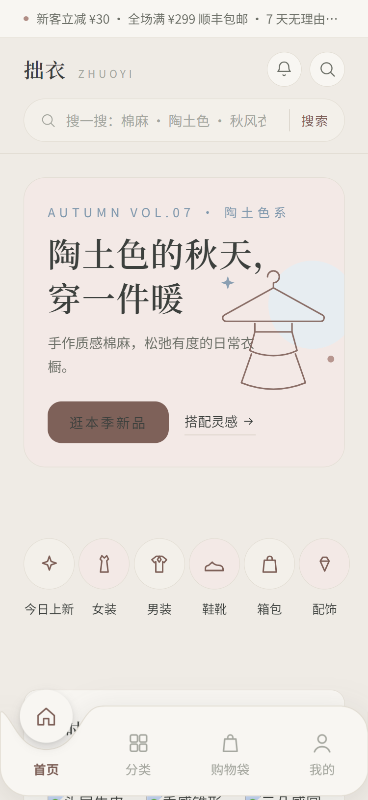
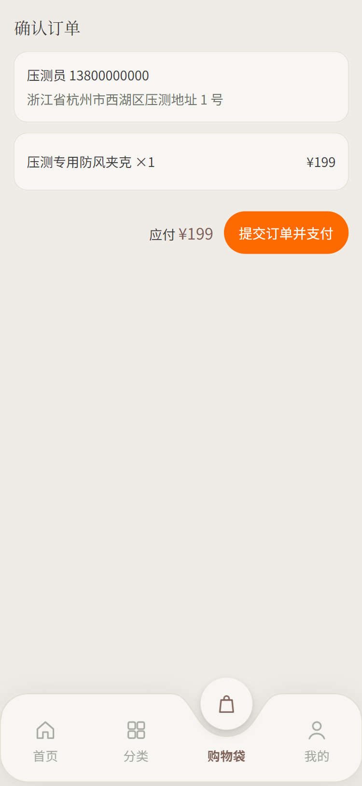
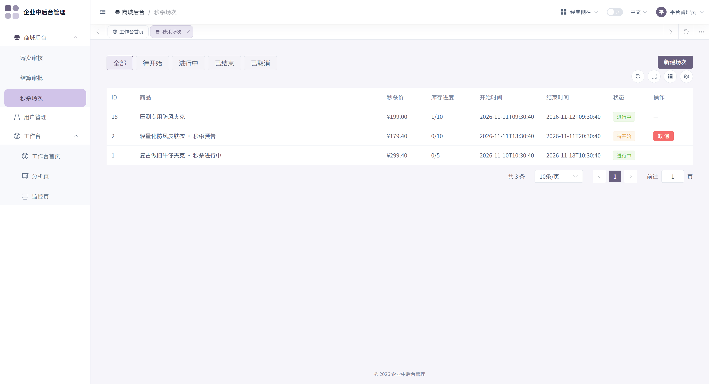
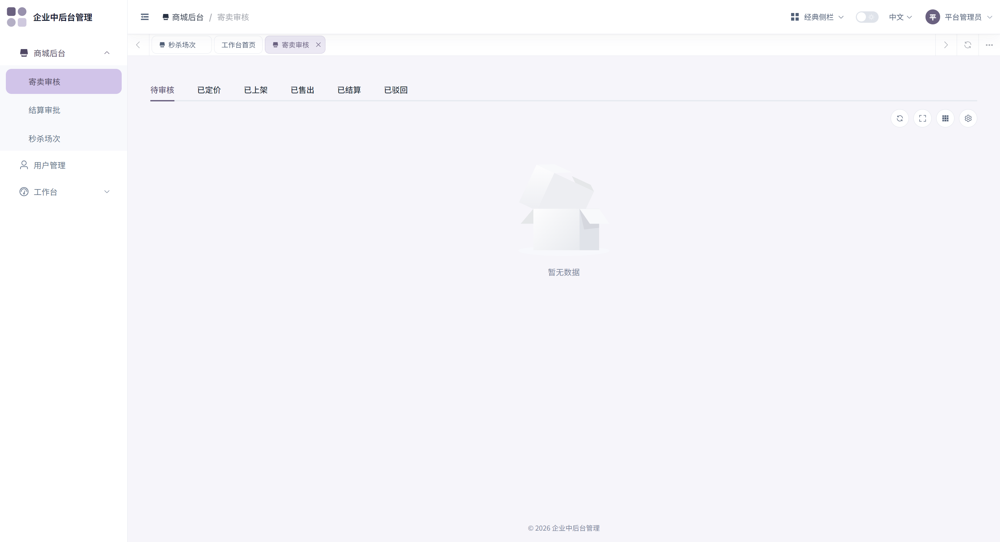
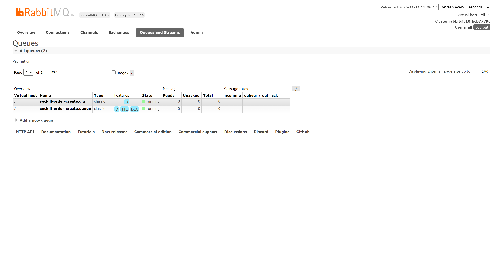

# full-stack-mall 转卖商城

四种玩法的全栈商城：**二手寄卖（主线）** + 限时秒杀 + 预售众筹 + 订阅盲盒（后两者 v2，枚举已占位）。Vue3 monorepo + Spring Boot + MySQL，**一条 `docker compose up` 起全栈**。

## 技术亮点

1. **秒杀三实现配置开关 + 三实现 × 五档并发对照实验**：`seckill.strategy=optimistic / pessimistic / redis` 一行切换。实测（500 线程抢 10 件库存，JMeter）：Redis 预扣受理即返 avg **954ms** vs DB 乐观锁 **1345ms** / 悲观锁 **1658ms**；15 组压测超卖/少卖全 0——[完整实测矩阵与拐点判读](backend/benchmark/README.md)
2. **Lua 预扣 + RabbitMQ 异步出单 + DLX 自动回补**：Redis Lua 原子扣减（含限购占位），受理表即本地消息表，`afterCommit` 发 MQ 防幽灵订单，消费失败 3 次进 DLX 自动回补库存与受理状态——取舍：**最终一致，宁可少卖不超卖**（宕机丢预扣=少卖可感知，超卖=资损不可接受）
3. **完整电商闭环**：JWT + HttpOnly Cookie 鉴权（SameSite=Lax）· 寄卖审核六态状态机 + 确认收货才结算 Payout · PaymentProvider 抽象（FakeProvider ↔ 支付宝沙箱可切换）· OrderItem 快照铁律（定格下单瞬间，永不回联）
4. **测试资产**：后端 209 用例（含 Testcontainers 真实 Redis/MySQL/RabbitMQ 集成测试）+ h5 142 用例 + 15 组压测对账存档（`backend/benchmark/results/*-reconcile.txt`）

## 功能截图

> 全部来自 `docker compose up` 全栈实截（2026-11-11），点击可放大。

| h5 买家端首页 | 寄卖商品详情（库存唯一） |
|---|---|
|  |  |

| 秒杀确认订单（收银台） | admin 秒杀场次管理 |
|---|---|
|  |  |

| admin 寄卖审核工作台 | RabbitMQ 异步出单队列（TTL + DLX） |
|---|---|
|  |  |

## 快速开始

```bash
# 体验全栈（推荐：Docker 一键起，对外仅 8080）
docker compose up -d --build   # web(nginx) + backend(Spring Boot JAR) + mysql + redis + rabbitmq
# 浏览器 http://localhost:8080/ → 自动跳 /h5/h5-mall（买家端）；/admin/ 管理端
# 秒杀演进体验：SECKILL_STRATEGY=redis docker compose up -d backend

# 开发调试（后端三件套 Docker + 应用本机 mvn；前端 pnpm 网关）
cd backend && docker compose up -d   # MySQL 13306 + Redis 6379 + RabbitMQ 5672/15672
mvn spring-boot:run                  # Spring Boot 18080，context-path /api
cd frontend && pnpm install && pnpm dev:gateway h5   # 网关 8080 同源代理（需 Node >=22.18，pnpm >=11）
```

> 改 `backend/sql/init.sql` 后须 `docker compose down -v` 重建卷——MySQL entrypoint 仅在空数据目录时执行初始化。compose 首次构建需 5-10min（前端 6 app 聚合构建）；Docker Desktop 内存建议 ≥4GB。

首次访问（全栈起来后）：

1. 浏览器开 `http://localhost:8080/`（F12 设备模式 375 宽更像手机）
2. 点底部「我的」tab——未登录会被守卫自动跳到登录页
3. 输演示账号登录：`buyer / buyer123`（买家）或 `seller / seller123`（卖家），登录后自动回跳订单页
4. 卖家视角：订单页顶部点「我是卖家 · 管理寄卖与售出订单」进工作台（寄卖接受定价 / 售出订单发货）

## 演示账号（init.sql 种子数据，BCrypt 哈希）

| 账号 | 密码 | 角色 | 用途 |
|------|------|------|------|
| `admin` | `admin123` | ADMIN | 管理后台（`http://localhost:8080/admin/`） |
| `seller` | `seller123` | USER | 演示卖家「阿珍的衣柜」：h5 卖家工作台（寄卖接受定价 / 售出订单发货） |
| `buyer` | `buyer123` | USER | 演示买家：h5 下单链路（我的订单 / 确认收货） |
| `perf001`~`perf500` | `admin123` | USER | 压测账号池（JMeter 对照实验用，500 个） |

> h5 为「全站公开」设计（浏览商品免登录），登录只发生在点「我的」或直达订单/工作台时。

## 核心洞察：四种玩法 = 两种货源

```
用户货源 ──→ 二手寄卖（C2C，用户既是买家也是卖家）

平台货源 ──→ 限时秒杀（自营尾货清仓）
         ──→ 订阅盲盒 / 预售众筹【v2】
```

`Product` 以 `ownerType`（自营/寄卖）+ `saleMode`（普通/秒杀/众筹/订阅）建模；寄卖商品全平台唯一一件（库存恒 1），自营商品才有规格库存池——统一由 `ProductItem` 承载。

## 架构形态

```
浏览器 ──→ web（nginx :8080，6 app 静态产物 + /api 反代）
              ├── /h5/ /admin/ /auth/ … SPA 静态托管（history fallback）
              └── /api/ ──▶ backend（Spring Boot JAR :18080，容器网络）
                                ├─▶ MySQL 8.4（init.sql 种子）
                                ├─▶ Redis 7（Lua 预扣 + 令牌桶限流）
                                └─▶ RabbitMQ 3.13（异步出单 + DLX 回补）
```

## 技术栈

| 层 | 技术 |
|---|---|
| 前端 | Vue 3 + TypeScript + Vite + Pinia（pnpm monorepo：apps/h5 买家端 Vant · apps/admin 管理端 Element Plus） |
| 后端 | Java 17 · Spring Boot 3.5.9 · MyBatis-Plus 3.5.18.1 |
| 数据库 | MySQL 8.4（Docker 卷持久化，种子幂等初始化） |
| 缓存/队列 | Redis 7（Lua 原子扣减 + 令牌桶）· RabbitMQ 3.13（异步出单削峰 + DLX） |
| 认证 | JWT + HttpOnly Cookie（SameSite=Lax） |
| 支付 | PaymentProvider 抽象：FakeProvider（开发）/ 支付宝沙箱（联调） |
| 部署 | Docker Compose 全栈（multi-stage JAR + nginx 静态托管，单对外口 8080） |

## 阶段路线（每阶段有可运行产物）

| 阶段 | 内容 | 产物 | 状态 |
|------|------|------|------|
| 0 | 需求梳理 + ER 图 + 接口契约 | 设计文档 | ✅ 2026-11-06 |
| 1 | 商品域重构 + JWT 鉴权 + 前端对接 | **能逛的商城** | ✅ 2026-11-06 |
| 2 | 寄卖全流程 + 地址 + 购物车 + 下单 + 模拟支付 | **能买能卖的商城 ⭐MVP** | ✅ 2026-11-09 |
| 3 | 订单流转 + Payout 结算 + 管理后台 + 统一登录 | **能运营的商城** | ✅ 2026-11-09 |
| 4 | 秒杀（条件更新 → Redis 预扣 + MQ 异步出单演进）+ 搜索优化 | **有技术深度的商城** | ✅ 2026-11-10（三实现对照实验 + 压测三层证据链） |
| 5 | 部署上线 + README 作品集化 | **作品集素材** | ✅ 2026-11-11 |

## 技术难点（本项目的技术含金量）

1. **防超卖三路线对照**：DB 条件更新（乐观锁）→ FOR UPDATE（悲观锁对照组）→ Redis Lua 预扣 + 异步落库——配置开关切换，压测拐点见 [benchmark/README.md](backend/benchmark/README.md)
2. **事务边界**：下单 = 建订单 + 扣库存 + 清购物车，原子性；Redis 路径以受理表 + afterCommit 发MQ 替代分布式事务
3. **支付幂等**：验签 + paymentNo 幂等 + 状态机单向迁移（异步回调驱动，不靠前端点击）
4. **寄卖审核流 + 分账结算**：ConsignmentListing 六态状态机；确认收货才生成 Payout——买家付款 ≠ 卖家钱到手
5. **快照铁律**：OrderItem 定格下单瞬间的价格/标题/成色，永不回联实时商品

## 目录结构

```
full-stack-mall/
├── frontend/   # Vue3 pnpm monorepo（apps/* × packages/*，治理规则见 frontend/AGENTS.md）
├── backend/    # Spring Boot（按业务分包，Dockerfile multi-stage，sql/init.sql 幂等可重跑）
├── docker-compose.yml   # 全栈编排（web + backend + mysql/redis/rabbitmq，仅 8080 对外）
└── docs/       # superpowers/specs 设计文档 · superpowers/plans 实施计划 · screenshots 截图
```

## 深读索引

- **设计基准（single source of truth）**：[docs/superpowers/specs/2026-11-06-resale-mall-design.md](docs/superpowers/specs/2026-11-06-resale-mall-design.md)
- **压测三层证据链**（对照实验矩阵 · 一致性四场景 · 取舍声明）：[backend/benchmark/README.md](backend/benchmark/README.md)
- 设计稿：`docs/superpowers/specs/`（阶段 4/4b/5）· 实施计划：`docs/superpowers/plans/`
- 前端工程规范：`frontend/AGENTS.md` · 变更记录：[CHANGELOG.md](CHANGELOG.md)

