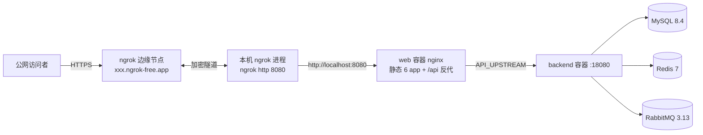

# 01-公网隧道在线演示指引

> 2026-11-12 实测落地 | 适用：把本机跑起来的全栈商城通过 ngrok 隧道临时暴露到公网，供他人访问演示。
> 定位：非生产部署路径。正式部署设计见 `docs/superpowers/specs/2026-11-11-阶段5-部署上线与README作品集化设计.md`，生产形态编排见根目录 `docker-compose.yml`。

## 1. 方案本质与边界

```
你的电脑 = 服务器（docker compose 全栈）   ngrok = 公网入口（隧道穿透）
电脑关机 / 休眠 / Docker 停止 / ngrok 进程退出  →  公网立即不可访问
```

| 项 | 说明 |
|---|---|
| 成本 | ¥0（ngrok 免费版：1GB/月流量、2 万请求/月、固定 1 个 dev 域名） |
| 域名 | **`parasail-deflected-cobweb.ngrok-free.dev`**（本实例，2026-11-12 记录；形态为 `xxx.ngrok-free.app`，随账号绑定，重启隧道不变；以 dashboard → Domains 页为准） |
| 代码时效 | 取决于本机镜像何时构建；如需最新代码须重新 `--build`（frontend 构建约 20~40 分钟） |
| 适用场景 | 临时演示、给同学/面试官看、简历作品链接（短期） |

## 2. 前置条件

- Docker Desktop 可用（内存建议 ≥ 6GB；本栈实测占用约 2.5GB）
- ngrok 账号 + authtoken 已绑定（`ngrok config check` 显示 Valid 即可）
- 已构建的项目镜像 `mall-backend:prod`、`vv-web:prod`（`docker images` 确认；缺失则 `docker compose up -d --build`）

## 3. 架构与数据流



要点：6 个前端 app 由 web 容器以子路径托管（`/portal/` `/admin/` `/h5/` `/auth/` `/big/` `/docs/`），API 经 nginx 反代走容器网络，不单独暴露端口。

## 4. 上线操作（实测命令序列）

```bash
# ① 启动全栈（项目根目录，即根 docker-compose.yml 所在）
docker compose up -d
docker compose ps          # 等待 5 个容器全部 healthy（约 1~2 分钟，MySQL 首次灌 init.sql）

# ② 本地验证（必须先通，再开隧道，否则无法区分故障层）
curl -s -o /dev/null -w "%{http_code}" http://localhost:8080/portal/   # 期望 200
curl -s "http://localhost:8080/api/mall/product/list?page=1&size=1"    # 期望 {"code":200,...}

# ③ 开隧道（前台运行，Ctrl+C 即断开）
ngrok http 8080
# 输出 "started tunnel ... url=https://xxx.ngrok-free.app" 即为公网地址
```

首次访问会出现 ngrok 反钓鱼提示页，点 "Visit Site" 继续（免费版固有，提前告知访问者）。

## 5. 访问入口与演示账号

当前实例访问地址（2026-11-12 记录，隧道运行时生效）：

| 入口 | 地址 |
|---|---|
| C 端门户 | https://parasail-deflected-cobweb.ngrok-free.dev/portal/ |
| 管理后台 | https://parasail-deflected-cobweb.ngrok-free.dev/admin/ |
| 移动端（商城首页） | https://parasail-deflected-cobweb.ngrok-free.dev/h5/h5-mall |
| 数据大屏 / 文档站 | `/big/`、`/docs/` 子路径同理 |

| 角色 | 账号 | 密码（init.sql 种子，**公网暴露必须改**） |
|---|---|---|
| 平台管理员 | `admin` | `admin123` |
| 卖家 | `seller` | `seller123` |
| 买家 | `buyer` | `buyer123` |

## 6. 日常运维

| 操作 | 命令 |
|---|---|
| 重新上线（开机后） | `docker compose up -d` + `ngrok http 8080`（两条即可，域名不变） |
| 停止对外服务 | ngrok 窗口 Ctrl+C；`docker compose stop web`（仅断公网，数据保留） |
| 全部下线 | `docker compose down`（卷内数据保留，下次 up 直接恢复） |
| 看容器状态 | `docker compose ps` / `docker compose logs -f backend` |
| 看隧道状态 | `curl -s http://127.0.0.1:4042/api/tunnels`（端口见 §7 说明） |

## 7. 故障排查

| 症状 | 排查命令 | 处理 |
|---|---|---|
| 隧道起不来，提示 can't bind web address | — | Windows 保留端口（Hyper-V 动态端口段）可能占用 4040；ngrok 会自动改用 4042，属正常，用 4042 查状态 |
| 公网 503 / 超时 | `docker compose ps` | 容器未 healthy；看 `docker compose logs backend` 多为 MySQL 初始化未完成，等待重试 |
| 公网提示页后白屏 | `curl -I https://parasail-deflected-cobweb.ngrok-free.dev/portal/` | 先确认本地 `:8080/portal/` 200；本地通则多为 ngrok 边缘抖动，重试或换网络 |
| 本机 curl 公网域名 TLS 握手挂起（exit 56） | 稍等 1~2 分钟重试 | 国内网络对 `*.ngrok-free.dev` 的 SNI 干扰呈间歇性；ngrok 边缘多 IP，重试可能换通。手机蜂窝流量成功率更高 |
| 额度用尽（请求返回 429） | ngrok dashboard → Usage | 免费版 1GB/月 + 2 万请求/月；超限等月度重置或升级 |

## 8. 安全红线（公网暴露时必读）

1. **隧道开着 = admin/admin123 暴露在公网爆破面上**。上线后第一件事：登录 `/admin/` 修改管理员密码（或数据库直改 BCrypt 哈希）。
2. 演示完毕随手关隧道（Ctrl+C），不要长期挂着。
3. 不在文档/截图中泄露 authtoken（`ngrok.yml`）；仓库内任何文件不得写入 token。
