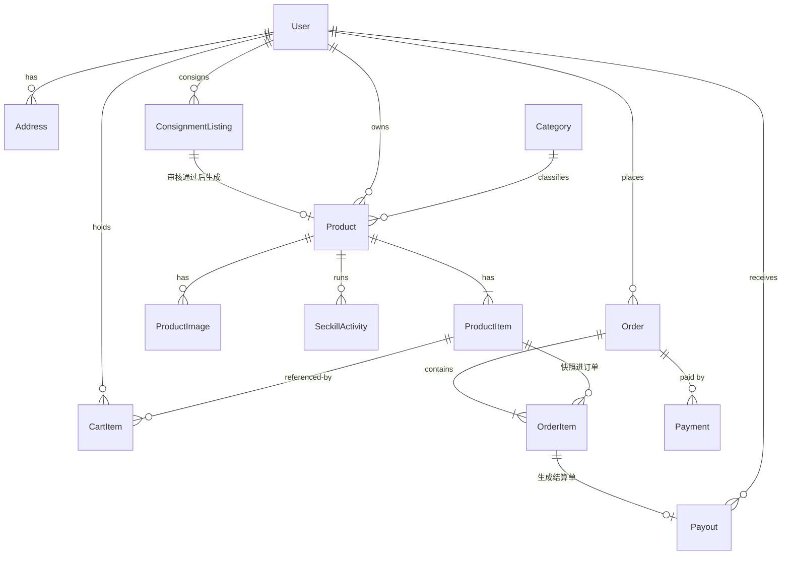
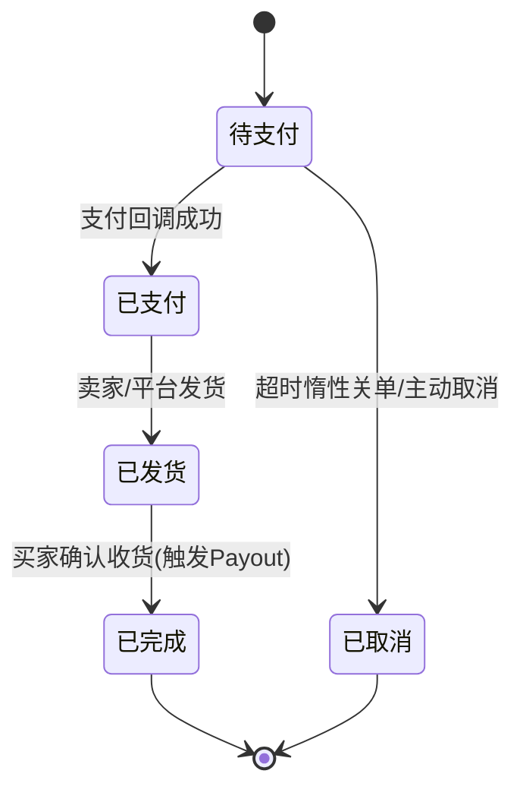
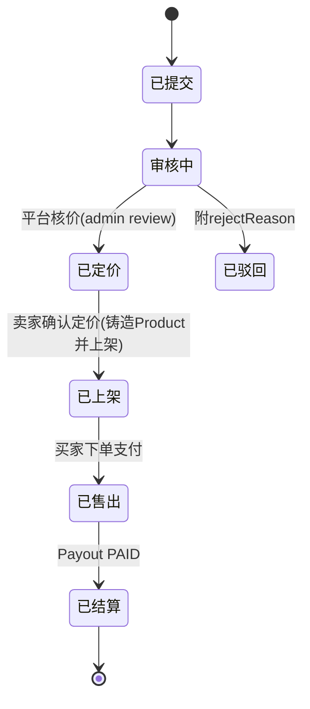
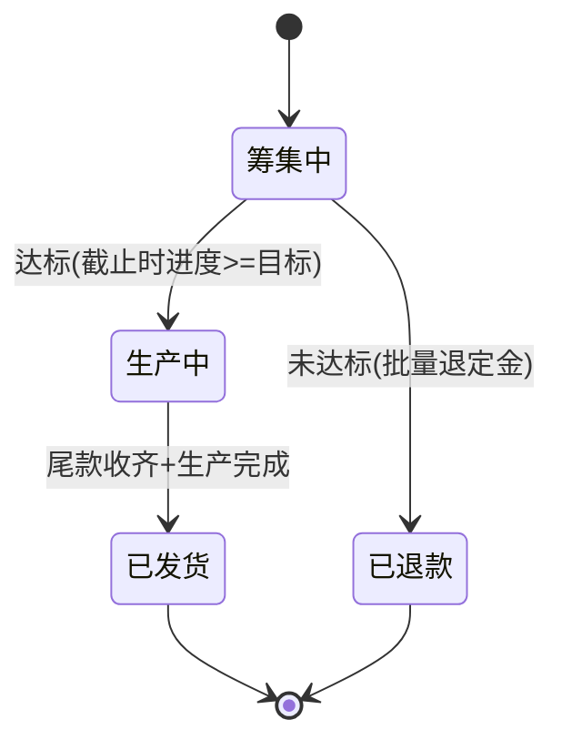

# 转卖商城设计文档：二手寄卖 + 秒杀 + 众筹 + 订阅盲盒（2026-11-06）

> **定位**：本文档是全项目的唯一设计基准（single source of truth）。后续每个阶段开工前，从本文档摘出该阶段范围写实施计划（writing-plans），实施计划不得与本文档冲突；冲突时先改文档再动手。
> **读者**：未来的你 + AI 协作者。每个关键决策都附"为什么"，这是面试讲项目时的素材。

---

## 1. 背景与目标

### 1.1 目标调整

| | 旧目标（slice1 已起步） | 新目标（本文档） |
|---|---|---|
| 定位 | 普通自营商城 | 四种玩法的转卖商城 |
| 玩法 | 只有普通售卖 | **二手寄卖（主线）** + 限时秒杀 + 预售众筹 + 订阅盲盒 |
| 货源 | 只有平台自营 | 用户货源（寄卖 C2C）+ 平台货源（自营） |
| 技术故事 | 超卖/事务/状态机 | + 审核流、分账结算、两阶段支付、周期扣款、高并发 |

### 1.2 Goals（做到才算成）

1. 用户既能买也能卖：寄卖全流程走通（提交 → 审核 → 定价 → 上架 → 售出 → 结算）
2. 买家完整闭环：逛 → 加购/抢购 → 下单 → 支付（沙箱）→ 收货 → 订单完成
3. 资金安全底线：买家付款 ≠ 卖家钱到手，确认收货后才生成结算单（Payout）
4. 每个阶段有可运行产物，最终部署上线、README 可作为作品集
5. 四种玩法共用一套商品/订单骨架，玩法是"插件"不是"分叉"

### 1.3 Non-goals（本期不做）

- 预售众筹、订阅盲盒的**业务实现**——v2 再做；但 `saleMode`/`orderType` 枚举从第一天就占位（`CROWDFUND`、`SUBSCRIPTION`），保证 v2 加玩法不改表结构
- 真实支付宝签约（用沙箱/FakeProvider 抽象，见 §7.3）
- 物流跟踪、客服、评价系统、搜索服务化（ES）——搜索优化在阶段 4 只做到数据库索引/缓存层面

### 1.4 Anti-goals（技术上做到了也算失败）

- 为"将来可能用到"提前抽象（如分布式事务框架、消息队列）——MVP 用数据库事务 + 条件更新，演进故事留到阶段 4
- 订单直接引用商品实时价格/标题（快照是铁律，见 §4.4）
- 靠"前端点击支付按钮"推进订单状态（必须以支付异步回调为准，见 §7.3）

---

## 2. 核心洞察：四种玩法 = 两种货源

这是整个项目最重要的一张图，先想明白货从哪来：

```
用户货源 ──→ 二手寄卖（C2C，用户既是买家也是卖家）

平台货源 ──→ 限时秒杀（自营尾货清仓）
         ──→ 订阅盲盒（自营平价款池，每月随机发）   【v2】
         ──→ 预售众筹（联名新款/工厂直供，先定金后生产）【v2】
```

**推论**：`Product` 表从设计之初就区分 `ownerType`（自营/寄卖）和 `saleMode`（普通/秒杀/众筹/订阅）。寄卖商品全平台唯一一件（库存恒为 1），自营商品才有库存池——这个差异贯穿所有后续设计。

**为什么寄卖必须第一批**：它是"转卖商城"的本体，决定了用户体系要有卖家身份、商品要挂卖家、资金要分账。先把这块骨架立稳，其他玩法都是往上挂插件。

### 玩法 × 技术深度对照（简历素材来源）

| 玩法 | 核心技术挑战 | 学到什么 | 批次 |
|------|-------------|---------|------|
| 二手寄卖 | 多角色 + 审核流 + 分账结算 | 业务建模能力 | **第 1 批（主线，阶段 2）** |
| 限时秒杀 | 条件更新防超卖 → Redis 预扣演进、限流 | 高并发 | **第 2 批（阶段 4）** |
| 预售众筹 | 两阶段支付（定金/尾款）、达标判定、批量退款 | 事务 + 定时任务 | v2 |
| 订阅盲盒 | 周期扣款、发货调度、盲盒去重算法 | 调度系统 | v2 |

---

## 3. 技术栈与架构形态（沿用 slice1 已定事实，不再重新选型）

```
浏览器 ──→ 前端 SPA（Vue3 monorepo：apps/h5 买家端，apps/admin 管理端）
              │  HTTP REST + JWT（HttpOnly Cookie）
              ▼
          Spring Boot API ──→ MySQL 8.4（Docker）
              │         └──→ Redis（阶段 4 秒杀演进时引入）
              └──→ 支付网关抽象（FakeProvider / 支付宝沙箱）
```

| 层 | 技术 | 备注 |
|---|---|---|
| 前端 | Vue3 + Vite + Pinia + Vant + UnoCSS（既有 monorepo） | h5 = 买家端；admin 子应用阶段 3 启用 |
| 后端 | Java 17 + Spring Boot 3.5.9 + MyBatis-Plus 3.5.18.1 | 按业务分包（product/user/cart/order/...） |
| 数据库 | MySQL 8.4（Docker，端口 13306，库 `mall`） | `init.sql` 幂等可重跑（DROP + CREATE） |
| 缓存 | Redis | **阶段 4 才引入**，MVP 不用 |
| 认证 | JWT 存 HttpOnly Cookie（SameSite=Lax）+ withCredentials | slice1 已定，CORS 已允许凭证 |
| 部署 | Docker + 云服务器 | 阶段 5 |

**既有约定继续有效**：统一信封 `{code, message, data}`（code=200 成功，与前端 `packages/shared/src/api/http.ts` 零适配）；分页 `{list, total, page, pageSize}`；后端端口 18080、context-path `/api`，Controller 映射以 `/mall` 开头；Entity 不出 Controller，出入参一律 DTO；单文件 ≤400 行。

---

## 4. 领域模型

### 4.1 ER 总图



五个实体域：**用户域**（User + Address）、**商品域**（Product + ProductItem + ProductImage + ConsignmentListing）、**交易域**（Order + OrderItem + Payment + Refund[v2]）、**玩法域**（SeckillActivity；CrowdfundCampaign / SubscriptionPlan 等 v2 再建表）、**资金域**（Payout）。

**用户域定义**：

```
User:    id / username(唯一) / password(BCrypt 哈希) / nickname / avatar
         role(USER|ADMIN) / status / createTime / updateTime
Address: id / userId / receiverName / phone / province / city / district / detail / isDefault
```

注册登录用用户名+密码；密码一律 BCrypt 哈希入库，禁止明文/可逆加密。`role` 字段区分买家/卖家（同一账号天然双角色，不卖货时就是买家）与 ADMIN；admin 账号由 `init.sql` 种子生成，所有 `/mall/admin/*` 端点在 JWT 解析后校验 `role=ADMIN`，否则 403。

### 4.2 ConsignmentListing 寄卖单 —— 本项目的灵魂

```
id / sellerId / brand / title / size / conditionGrade(成色枚举)
images(JSON 数组，图床 URL，多角度成色实拍) / description
expectedPrice(卖家期望价) / platformPrice(平台核价) / commissionRate(抽佣%)
status: SUBMITTED → REVIEWING → PRICED → LISTED → SOLD → SETTLED
              ↘ REJECTED(附 rejectReason)
listedProductId(卖家确认定价后生成的商品 ID)
```

**关键决策：寄卖单和商品是两个实体，卖家确认定价那一刻才"铸造"出 Product（PRICED → LISTED 时生成）。** 这样审核队列、定价协商的历史都留在寄卖单里，不污染商品表；卖家对平台核价保有接受/不接受的权利——这个博弈环节正是转卖平台的真实业务逻辑。成色分级（conditionGrade）是二手平台的灵魂字段。

**图片策略（MVP）**：寄卖提交时图片存图床 URL 字符串数组（JSON 列），不做真实文件上传；铸造时迁移到 `product_image` 表。真实上传/OSS 是 v2 的事。

### 4.3 Product + ProductItem —— 统一单件/规格表

```
Product:      id / categoryId / ownerType(PLATFORM|CONSIGNMENT) / saleMode(NORMAL|SECKILL|CROWDFUND|SUBSCRIPTION)
              name / brand / tag / sellingPoint / sales / status / detailHtml / sellerId(寄卖商品记录卖家)
ProductItem:  id / productId / size / color / conditionGrade / price / originPrice / stock / version(乐观锁)
ProductImage: id / productId / url / sort
```

- **寄卖商品**：一条 ProductItem 记录，`stock=1`，`conditionGrade` 必填（成色是单件属性）
- **自营商品**：S/M/L/XL 多条记录，新品 `conditionGrade` 固定 `NEW`
- **秒杀防超卖**靠 ProductItem 的条件更新 + `version` 乐观锁
- 寄卖商品需要多角度成色实拍图，所以图片从 slice1 的单字段拆为 `ProductImage` 表；列表主图取 `sort=0`

### 4.4 Order + OrderItem —— 快照是铁律

```
Order:     id / orderNo / userId / type(NORMAL|SECKILL|CROWDFUND|SUBSCRIPTION)
           status / payAmount / addressSnapshot(JSON) / expiredAt(关单时间)
OrderItem: orderId / productItemId / itemSnapshot(JSON: 标题|图片|成色|尺码)
           price(成交价快照) / quantity / sellerId(寄卖件记录卖家，结算要用)
```

**订单永不直接引用实时价格和卖家改后的标题**——三年后回看订单，必须还是下单那一刻的样子。`sellerId` 冗余在 OrderItem 上，结算时不用回联商品。

### 4.5 Payment + Payout —— 钱的两条线

```
Payment: id / paymentNo / orderId / amount / provider(FAKE|ALIPAY_SANDBOX)
         status: CREATED → PAYING → SUCCESS / FAILED   （一单可多次尝试支付）
Payout:  id / sellerId / orderItemId / sellerAmount / commission
         status: PENDING → CONFIRMED → PAID
```

**买家付款成功 ≠ 卖家钱到手。** 订单确认收货后才生成 Payout，平台审核后打款——这是 C2C 平台的资金安全底线。

### 4.6 SeckillActivity 秒杀场次

```
id / productId / seckillPrice / seckillStock(独立库存池) / soldCount
startTime / endTime / limitPerUser(限购) / status: PENDING → ACTIVE → ENDED
```

秒杀库存从自营库存划拨、独立扣减，活动结束未售罄的量还回商品库存。**寄卖商品（库存恒 1）不参与秒杀。**

---

## 5. 三条关键状态机





> 注：卖家不接受核价时寄卖单停留在「已定价」，MVP 不做"拒绝定价"流转（v2 可加退回/关闭）。



> 第三条（众筹）v2 才实现，状态机现在定好，防止订单模型设计时漏掉扩展点。

---

## 6. 接口契约

统一信封 `{code, message, data}`，code=200 成功；业务错误用非 200 code + 中文 message（与现有前后端约定一致）。

| 模块 | 接口 | 阶段 |
|------|------|------|
| 认证 | `POST /mall/auth/register` · `POST /mall/auth/login` · `POST /mall/auth/logout` · `GET /mall/auth/me` | 1 |
| 商品 C 端 | `GET /mall/product/list`（关键词/品牌/成色/价格区间/排序/分页）· `GET /mall/product/{id}` · `GET /mall/product/category/tree` | 1（重构） |
| 地址 | `GET /mall/addresses` · `POST /mall/addresses` · `PATCH /mall/addresses/{id}` · `DELETE /mall/addresses/{id}`（含默认地址标记） | 2 |
| 寄卖 | `POST /mall/consignments` 提交 · `GET /mall/consignments/mine` · `GET /mall/consignments/{id}` · `POST /mall/consignments/{id}/accept`（卖家确认定价 → 铸造 Product 上架） | 2 |
| 寄卖管理 | `GET /mall/admin/consignments?status=REVIEWING` · `POST /mall/admin/consignments/{id}/review`（核价通过→PRICED / 驳回→REJECTED 附原因）· `POST /mall/admin/consignments/{id}/settle`（结算打款） | 3 |
| 购物车 | `GET /mall/cart` · `POST /mall/cart/items` · `PATCH /mall/cart/items/{id}` · `DELETE /mall/cart/items/{id}` | 2 |
| 订单 | `POST /mall/orders` · `GET /mall/orders?status=` · `GET /mall/orders/{id}` · `POST /mall/orders/{id}/cancel` · `POST /mall/orders/{id}/ship`（卖家发寄卖件 / admin 发自营件）· `POST /mall/orders/{id}/confirm`（确认收货→触发 Payout） | 2-3 |
| 支付 | `POST /mall/payments/{paymentNo}/pay`（返回沙箱跳转 URL）· `POST /mall/payments/alipay/notify`（异步回调）· `GET /mall/payments/{paymentNo}`（前端轮询） | 2 |
| 秒杀 | `GET /mall/seckill/active` · `POST /mall/seckill/{activityId}/orders` | 4 |
| 自营后台 | `POST /mall/admin/products` · `PATCH /mall/admin/products/{id}` · `POST /mall/admin/seckill-activities` | 3-4 |

### 精讲契约 1：`POST /mall/seckill/{activityId}/orders` —— 错误码最丰富的一个

```
入参: { productItemId, quantity: 1 }   (登录态)
成功: { orderNo, paymentNo }       → 直接跳支付，不进购物车
错误码:
  40001 SECKILL_NOT_STARTED   未开始/已结束
  40002 SOLD_OUT              库存扣减失败（条件更新影响行数=0）
  40003 LIMIT_EXCEEDED        超过限购
  40004 DUPLICATE_ORDER       同一活动重复下单（userId+activityId 唯一约束兜底）
执行顺序: 限流 → 查活动状态 → 条件 UPDATE 扣库存 → 建订单(PENDING_PAYMENT) → 返回
```

### 精讲契约 2：`POST /mall/payments/alipay/notify` —— 幂等三件套

1. **验签**：用支付宝公钥验证 sign，失败直接返回 failure
2. **幂等**：以 paymentNo 查库，status 已是 SUCCESS → 直接返回 success（重复回调无害）
3. **状态机单向**：只有 PAYING → SUCCESS 允许迁移，且校验回调金额 == 应付金额

---

## 7. 贯穿性技术决策

| # | 决策 | 方案 | 为什么 |
|---|------|------|--------|
| 1 | 超时关单 | **惰性关单**：订单写 `expiredAt`，查询时发现超时未支付 → 标记取消 + 还库存 | MVP 不用定时任务，一行事务搞定；v2 再讲"延迟队列"的演进故事 |
| 2 | 防超卖 | 数据库**条件更新**：`UPDATE ... SET stock=stock-1 WHERE id=? AND stock>=1`，影响行数=0 即卖完 | 不引 Redis 就能保证正确；秒杀场景阶段 4 演进为"Redis 预扣 + 异步落库" |
| 3 | 支付抽象 | `PaymentProvider` 接口 + 两个实现：`FakeProvider`（开发用）/ `AlipaySandboxProvider` | 本地开发不依赖外网，联调时切换实现即可 |
| 4 | 玩法扩展 | `saleMode`/`orderType` 枚举含 CROWDFUND/SUBSCRIPTION 占位 | v2 加玩法不改表结构，枚举先行 |
| 5 | 寄卖铸造时机 | ConsignmentListing 在**卖家确认定价**那一刻才生成 Product（PRICED → LISTED）| 审核历史留在寄卖单，不污染商品表；卖家对平台核价保留接受权 |

---

## 8. 页面地图：一个详情页，四种形态

C 端页面按 `saleMode` 变形，这是本项目最出彩的设计点：

```
商品详情页 = 通用骨架 + 玩法插件：
  秒杀商品 → 渲染倒计时 + 抢购进度条          【阶段 4】
  众筹商品 → 渲染进度条（已筹 78%）+ 档位选择   【v2】
  寄卖商品 → 渲染成色报告 + 卖家卡片           【阶段 2】
  普通商品 → 标准规格选择                      【阶段 1】
```

| 端 | 页面 | 阶段 |
|---|---|---|
| h5 买家端 | 首页 / 列表 / 详情 / 登录注册 | 1 |
| h5 买家端 | 寄卖提交、我的寄卖（含定价确认）、购物车、下单、支付、订单列表/详情、确认收货 | 2-3 |
| admin 管理端 | 寄卖审核队列、定价、结算审批 | 3 |
| admin 管理端 | 自营商品管理、秒杀场次管理 | 3-4 |
| h5 买家端 | 秒杀会场页、详情页秒杀插件 | 4 |

---

## 9. 阶段路线：每阶段都有可运行产物

| 阶段 | 内容 | 产物 | 验收标准（手动可验证） |
|------|------|------|------|
| **0** | 需求梳理 + ER 图 + 页面地图 + 接口契约 | 本文档 | 文档经独立审查 + 你批准 |
| **1** | 商品域按新模型重构（ProductItem/ownerType/saleMode）+ JWT 鉴权 + 前端对接 | **能逛的商城** ✅ 2026-11-06 | 浏览器里注册/登录拿到 Cookie；首页/列表/详情全部走后端 API，硬编码 `mall.ts` 退役 |
| **2** | 寄卖全流程（提交→平台核价→卖家确认→铸造上架）+ 地址管理 + 购物车 + 下单 + 模拟支付（FakeProvider + 异步回调幂等）| **能买能卖的商城 ⭐MVP** | 卖家提交寄卖 → admin 核价 → 卖家确认定价 → 商品上架 → 买家下单 → 支付回调 → 订单已支付；重复回调不重复推进 |
| **3** | 订单流转（发货/确认收货/惰性关单）+ Payout 结算 + admin 后台（寄卖审核队列、结算审批）| **能运营的商城** | 确认收货生成 Payout 且金额=成交价×(1-抽佣)；超时未支付订单查询时自动取消并还库存 |
| **4** | 秒杀上线（条件更新 → Redis 预扣演进）+ 列表搜索优化 | **有技术深度的商城** | 秒杀四个错误码齐全；并发压测（如 200 线程抢 10 件）不超卖、限购生效 |
| **5** | 部署上线 + README 作品集化 | **作品集素材** | 公网可访问；README 含架构图、演示截图、技术难点讲解 |

> 阶段 0-1 = 设计 + 骨架跑通；阶段 2 = MVP 核心；阶段 3 = 运营闭环；阶段 4-5 = 亮点与上线。每个阶段开工前从本文档摘范围写实施计划（writing-plans），TDD 推进，一个功能一个 commit。

---

## 10. slice1 重构说明（推翻什么、为什么）

slice1 已完成商品展示切片（13 条种子、4 个接口全绿），但它的 `Product` 模型（价格/库存直接挂商品表）与新蓝图冲突。项目无生产数据，**推翻重构一步到位**，代价最低：

| slice1 现状 | 重构后 | 原因 |
|---|---|---|
| `product.price/stock/origin_price` | 下沉到 `product_item` | 寄卖恒 1 与自营多规格统一建模 |
| `product.image_url` 单字段 | `product_image` 表 | 寄卖需要多角度成色实拍 |
| `product` 无身份字段 | 加 `owner_type`/`sale_mode`/`seller_id` | 两种货源是项目的根 |
| 种子 13 条平移 mall.ts | 种子重写：自营多规格 + 寄卖单件混合 | 阶段 1 就要展示两种货源并存 |
| 接口 `list/detail/category/home` | 保留路径，DTO 适配新模型 | 前端对接契约尽量稳定 |

---

## 11. 落地方法论（怎么把全栈项目真正做出来）

> 这一节是教学主线：**你当决策者，AI 当执行者**。每个阶段都按下面节奏走。

### 11.1 每阶段开工五步法

1. **摘范围**：从本文档 §9 摘出本阶段范围，让 AI 写实施计划（writing-plans），计划必须含文件清单 + 接口签名 + 验收步骤
2. **契约先行**：动手前先要接口定义（入参/出参/错误码），你确认后再写代码——前后端都按契约并行干活
3. **TDD 小步跑**：先写失败测试 → 实现 → 转绿；一个功能一个 commit（中文约定式），跑通再下一个，别让 AI 一次生成 500 行
4. **决策留痕**：每次让 AI 出 2 个方案（如"购物车存数据库还是 Redis？"），你来选并在实施计划里写下理由——这就是 §7 那张表的来源
5. **验收闭环**：按计划里的验收步骤手动过一遍（curl / 浏览器），通过才进下一阶段

### 11.2 报错先自己读（调试纪律）

遇到报错先形成假设再让 AI 验证，否则学不到东西：
- L1 读堆栈：第一个指向**你自己代码**的帧是哪行？
- L2 回溯数据：报错行的数据从哪来？
- L3 加临时日志验证假设
- L4 定位根因：数据问题还是逻辑问题？
- L5 基于根因修复，**禁止**没看到堆栈就加 `?.` / try-catch 糊住症状

### 11.3 关键设计直觉（会在面试被问）

- **为什么订单存快照**：商品价格会改、卖家会改标题，订单是法律凭证，必须定格在下单瞬间
- **为什么寄卖单和商品分离**：审核是流程、商品是货架，流程的历史不能污染货架
- **为什么确认收货才结算**：C2C 平台要先拿到"买家没异议"这个事实，钱才能给卖家
- **为什么秒杀库存独立成池**：活动库存和常规库存生命周期不同（开抢划拨、结束归还），混在一起必超卖

---

## 12. 决策记录

### 12.1 你已拍板（2026-11-06）

| # | 决策 | 你的选择 |
|---|------|---------|
| 1 | 商城目标 | 四玩法转卖商城，寄卖为第一批主线 |
| 2 | 阶段 1 验收 | 前端对接后端，浏览器里真的能逛 |
| 3 | slice1 处置 | 按新蓝图推翻重构（ProductItem 下沉 + init.sql 重写）|
| 4 | 众筹/盲盒 | v2 实现，枚举现在占位 |
| 5 | 技术栈 | 沿用 slice1（Java 17 / SB 3.5.9 / MyBatis-Plus / MySQL 8.4 / Vue3 monorepo）|

### 12.2 我的判断（你可以推翻）

| # | 判断 | 理由 |
|---|------|------|
| 1 | 列表页展示价 = 该商品所有在售 ProductItem 的 `min(price)`（"¥xx 起"） | 多规格商品的常规做法，避免在 product 表冗余价格 |
| 2 | 阶段 1 的 `init.sql` 一次建好全部 MVP 核心表（user/address/consignment/cart/order/payment/payout/seckill_activity） | 幂等可重跑，避免每阶段改表迁移；v2 只需新建玩法表 |
| 3 | 管理后台复用 monorepo 已有的 `apps/admin` 子应用 | 结构已存在，阶段 3 不用新建工程 |
| 4 | 信封继续 code=200 成功（不用蓝图中示意的 code=0） | 与现有前端 http.ts、后端 Result 零适配 |
| 5 | 阶段 3 才做寄卖审核/结算的 admin 页面，阶段 2 审核动作用 SQL/接口直接完成 | 阶段 2 聚焦 MVP 闭环，后台页面是运营效率工具 |
| 6 | 用户体系：用户名+密码注册登录、BCrypt 哈希、`role(USER/ADMIN)`、admin 账号种子生成 | 行业标配；同一账号天然买家/卖家双角色，不拆表 |
| 7 | 寄卖图片 MVP 存图床 URL 字符串数组，不做真实文件上传 | 本项目技术故事在交易链路，上传/OSS 是 v2 的事 |
| 8 | 发货接口 `POST /orders/{id}/ship`：卖家发寄卖件、admin 发自营件，同一端点按角色鉴权 | 寄卖件物流主体是卖家，自营件是平台；一个端点两种权限校验 |
| 9 | 地址 CRUD 并入阶段 2（下单需要地址快照来源） | 没有地址管理就无法完成下单闭环 |
| 10 | 订单表名 `orders`（`order` 是 MySQL 保留字） | DDL 层面必须规避，实体类不受影响 |
| 11 | 用户种子走 init.sql 预计算 BCrypt 哈希（PasswordHashPrinter 测试生成+自校验），不用应用层 DataInitializer | 寄卖演示商品的 seller_id 需要种子卖家已存在；种子集中一处可重跑 |
| 12 | `ProductListRequest.discountOnly` 对外可传（首页"限时甄选"复用列表查询） | 一处聚合查询维护；外部传参无害（只读过滤） |
| 13 | Mapper 注册用接口级 `@Mapper` 注解，不用 `@MapperScan`（slice1 既定） | 避免 @WebMvcTest 切片误注册 Mapper Bean |

### 12.3 待定（到对应阶段再定）

- 登录/注册接口限流与失败计数（独立审查 HIGH 项，本地阶段不阻断）——阶段 2 网关层
- 订单号 `orderNo` 生成规则（时间戳+随机 or 雪花）——阶段 2 实施计划里定
- 购物车选中态/失效商品策略——阶段 2
- Redis 预扣的具体键设计——阶段 4
- 部署目标（云服务器厂商/域名）+ JWT/DB 密钥默认值 fail-fast 检测——阶段 5

---

## 13. 文档同步义务

- 本文档变更 → 同步更新 README（项目门面）与对应阶段实施计划
- 每阶段完成后在 §9 表格标注完成日期
- v2 启动众筹/盲盒时，先回到本文档补 §4 玩法域表结构，再写实施计划
